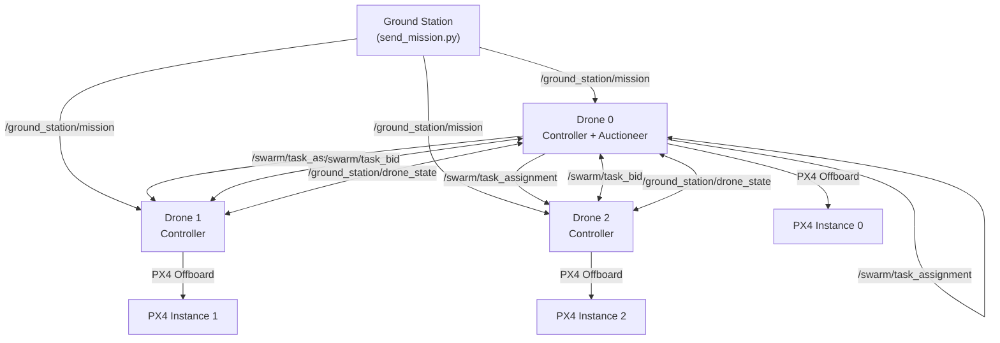
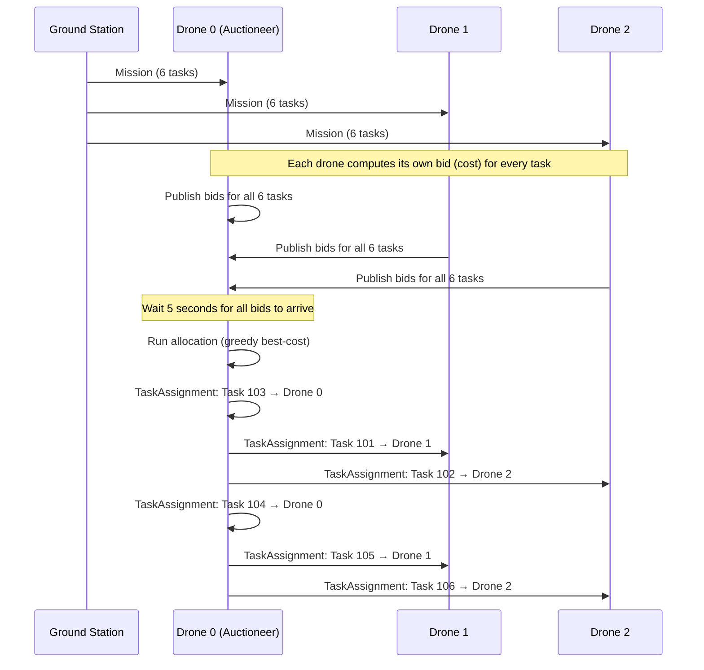
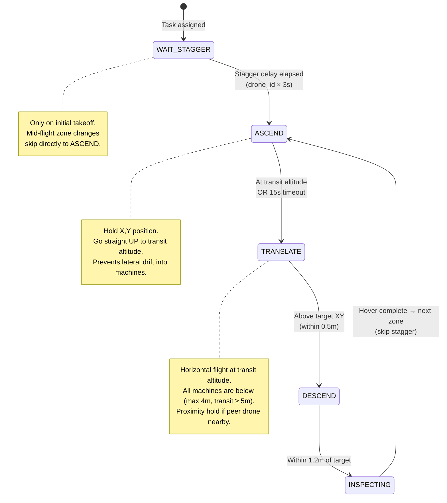
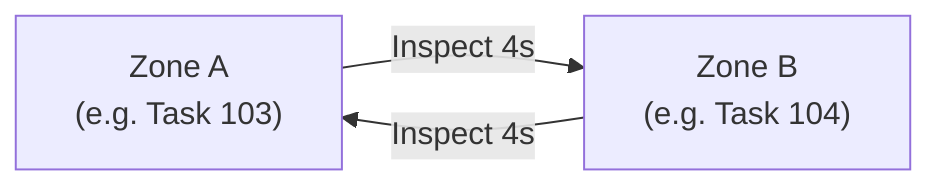

# Factory Patrol Simulation — Algorithm Deep Dive

## System Architecture



Each drone runs the **same binary** ([`patrol_controller.c`](file:///home/mrweirdo/factory_patrol_sim/factory_patrol_ws/patrol_controller/src/patrol_controller.c)), differentiated only by its ID (passed as a CLI argument). **Drone 0** has a special additional role as the **auctioneer/orchestrator**.

---

## 1. Auction-Based Task Allocation

> Implemented in [`auction_logic.c`](file:///home/mrweirdo/factory_patrol_sim/factory_patrol_ws/patrol_controller/src/auction_logic.c)

This is a **centralized single-round auction** inspired by market-based multi-robot task allocation (MRTA).

### How It Works



### Cost Function

Each drone computes a **cost** for each task ([`auction_calculate_cost`](file:///home/mrweirdo/factory_patrol_sim/factory_patrol_ws/patrol_controller/src/auction_logic.c#L95-L116)):

$$\text{cost}(d, t) = \underbrace{\sqrt{\Delta x^2 + \Delta y^2 + \Delta z^2}}_{\text{Euclidean distance}} + \underbrace{N_{\text{assigned}}(d) \times 15}_{\text{Workload penalty}} + \underbrace{(100 - \text{battery}_d) \times 0.2}_{\text{Battery penalty}}$$

| Term | Purpose |
|---|---|
| **Distance** | Prefer the nearest drone to each task |
| **Workload penalty** (\$15 per existing assignment) | Balance tasks evenly across drones — prevents one drone from hogging all tasks |
| **Battery penalty** | Prefer drones with more battery remaining |

### Allocation Algorithm

[`auction_run_allocation`](file:///home/mrweirdo/factory_patrol_sim/factory_patrol_ws/patrol_controller/src/auction_logic.c#L118-L154) uses a **greedy sequential assignment**:

```
max_per_drone = ceil(num_tasks / num_healthy_drones)

for each unassigned task:
    best_cost = ∞
    best_drone = NONE
    
    for each healthy drone:
        if drone's assigned count < max_per_drone:
            cost = calculate_cost(drone, task)
            if cost < best_cost:
                best_cost = cost
                best_drone = drone
    
    assign task → best_drone
    return (one assignment per call)
```

Key design decisions:
- **`max_per_drone` cap** ensures equal distribution (with 6 tasks and 3 drones → max 2 each)
- The workload penalty in the cost function provides a second layer of balancing beyond the hard cap
- Allocation runs in Drone 0's timer callback, assigning **all unassigned tasks in one tick** via a `while` loop

---

## 2. Navigation State Machine

> Implemented in [`update_task_execution`](file:///home/mrweirdo/factory_patrol_sim/factory_patrol_ws/patrol_controller/src/patrol_controller.c#L308-L398)

Each drone navigates using a **4-phase safe transit** pattern to avoid collisions with factory machines:



### Altitude Layering Strategy

The factory uses **vertical separation** to prevent mid-air collisions between drones:

| Layer | Drone 0 | Drone 1 | Drone 2 |
|---|---|---|---|
| **Transit** (horizontal flight) | -5.0m (5m AGL) | -5.5m (5.5m AGL) | -6.0m (6m AGL) |
| **Patrol** (idle hover) | -2.5m | -3.5m | -4.5m |
| **Inspection** (task-specific) | from mission data | from mission data | from mission data |

> Machine tops are at max 4m. Transit layer starts at 5m → **1m minimum clearance**.
> Factory ceiling is at 12m → **6m headroom** above highest transit lane.

### Phase Details

**Phase 0 — WAIT_STAGGER**: Only used on the very first takeoff. Each drone waits `drone_id × 3 seconds` before ascending, preventing simultaneous takeoff from adjacent ground positions. Subsequent zone transitions skip this phase entirely (`initial_takeoff_done` flag).

**Phase 1 — ASCEND**: The drone goes straight up while locking its horizontal position (`target_x = current_x`). This is critical — without it, the drone would drift toward the task target while still at low altitude, potentially hitting machines. Transitions when within 0.8m of transit altitude, or after a 15-second timeout.

**Phase 2 — TRANSLATE**: Horizontal flight at the drone's exclusive transit altitude. Since all obstacles are below, this is the safe corridor. Includes **proximity hold** (see below). Transitions when horizontally within 0.5m of the target XY.

**Phase 3 — DESCEND**: Vertical drop from transit altitude to the inspection altitude. Since the drone is already directly above the target, this is a straight descent.

---

## 3. Zone Patrol Looping

Each drone maintains an independent list of its assigned patrol zones ([`my_zones[]`](file:///home/mrweirdo/factory_patrol_sim/factory_patrol_ws/patrol_controller/src/patrol_controller.c#L82-L85)) and loops through them continuously:



- Zones are collected in [`task_assignment_callback`](file:///home/mrweirdo/factory_patrol_sim/factory_patrol_ws/patrol_controller/src/patrol_controller.c#L254-L285) as assignment messages arrive — deduplicated to prevent double-registration
- After completing an inspection, [`start_next_zone`](file:///home/mrweirdo/factory_patrol_sim/factory_patrol_ws/patrol_controller/src/patrol_controller.c#L287-L306) immediately begins the next zone using modular indexing (`my_zone_index = (idx + 1) % my_zone_count`)
- The drone loops its zones **forever** — the patrol never stops unless the drone runs out of battery

---

## 4. Collision Avoidance — Proximity Hold

> Implemented in [`check_peer_proximity`](file:///home/mrweirdo/factory_patrol_sim/factory_patrol_ws/patrol_controller/src/patrol_controller.c#L216-L252)

During the TRANSLATE phase, each drone checks if any **higher-priority peer** (lower drone ID) is within 2.5m of its target:

$$d^2 = (p_x - t_x)^2 + (p_y - t_y)^2 + (p_z - t_z)^2$$

If \(d^2 < 6.25\) (2.5m²) **and** the peer has a lower ID → **HOLD**. The drone freezes at its current position and waits until the path is clear.

**Priority rule**: Lower drone ID always has right-of-way. This prevents deadlocks — two drones can never block each other because one always has higher priority and keeps moving.

---

## 5. Fault Tolerance — Heartbeat & Task Reassignment

### Heartbeat Monitoring

Every drone publishes its [`DroneState`](file:///home/mrweirdo/factory_patrol_sim/factory_patrol_ws/src/patrol_msgs/msg/DroneState.msg) (position, battery, state) every 100ms on `/ground_station/drone_state`.

Drone 0's orchestrator calls [`auction_check_peer_timeouts`](file:///home/mrweirdo/factory_patrol_sim/factory_patrol_ws/patrol_controller/src/auction_logic.c#L172-L183) every tick:
- If a drone hasn't sent a heartbeat in **5 seconds** → marked as `FAILED`
- All tasks assigned to the failed drone are revoked and **re-auctioned** to remaining healthy drones

### Task Reassignment on Failure

[`auction_handle_drone_failure`](file:///home/mrweirdo/factory_patrol_sim/factory_patrol_ws/patrol_controller/src/auction_logic.c#L156-L170):

```
for each task assigned to failed_drone:
    task.assigned_drone = UNASSIGNED
    recalculate bids from remaining healthy drones
    
→ next allocation tick picks up these tasks and reassigns them
```

### Battery Failsafe

Battery drains at **0.01% per tick** (0.1%/sec, ~6%/min). When battery drops below 20%:
1. Drone enters `DRONE_STATE_RETURNING`
2. Ascends to transit altitude → flies to spawn position → descends
3. Marked as **unhealthy** in the auction system
4. Its tasks are reassigned to remaining drones
5. If ALL drones are unhealthy → Drone 0 publishes a `SwarmStatus` alert to the ground station

---

## 6. Task Recycling — Continuous Patrol

> Implemented in [`auction_recycle_tasks_if_all_completed`](file:///home/mrweirdo/factory_patrol_sim/factory_patrol_ws/patrol_controller/src/auction_logic.c#L185-L216)

When **all tasks** are marked as `completed` (every zone has been inspected once):

```
for each task:
    task.active = true
    task.completed = false
    task.assigned_drone = UNASSIGNED
    recalculate all bids

→ triggers a fresh allocation round → new patrol cycle begins
```

This creates an **infinite surveillance loop** — the factory is never left unmonitored.

---

## 7. PX4 Integration — Offboard Control

The controller communicates with PX4 via the **micro-XRCE-DDS** bridge (ROS 2 ↔ PX4):

| What | Topic | Rate |
|---|---|---|
| **Position commands** | `/px4_N/fmu/in/trajectory_setpoint` | 10 Hz |
| **Control mode** | `/px4_N/fmu/in/offboard_control_mode` | 10 Hz |
| **Arm + Offboard mode** | `/px4_N/fmu/in/vehicle_command` | 1 Hz |
| **Odometry feedback** | `/px4_N/fmu/out/vehicle_odometry` | On new data |

The coordinate transform between global factory frame and PX4's local NED frame:
- **Factory → PX4**: `px4_pos = factory_pos - spawn_offset`
- **PX4 → Factory**: `factory_pos = px4_pos + spawn_offset`

This allows all drones to share a common factory coordinate system while each PX4 instance operates in its own local frame.
