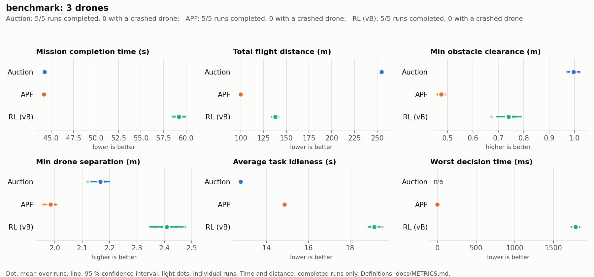
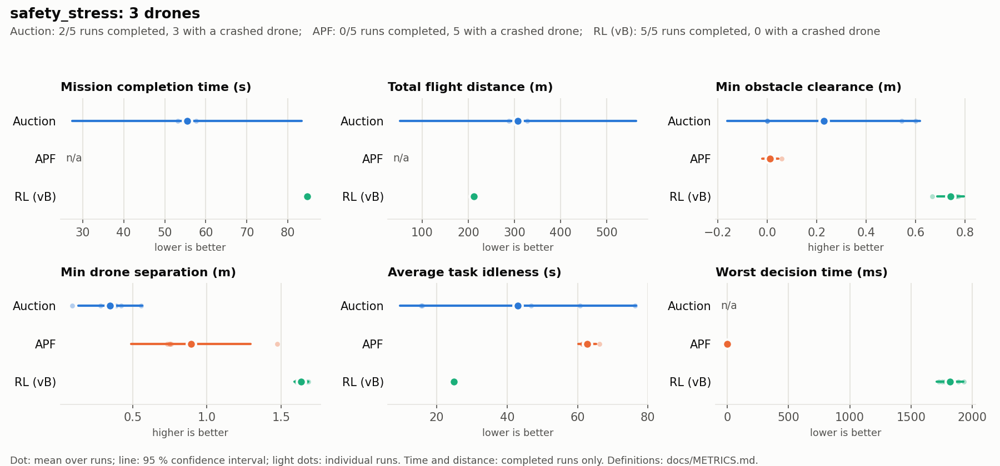
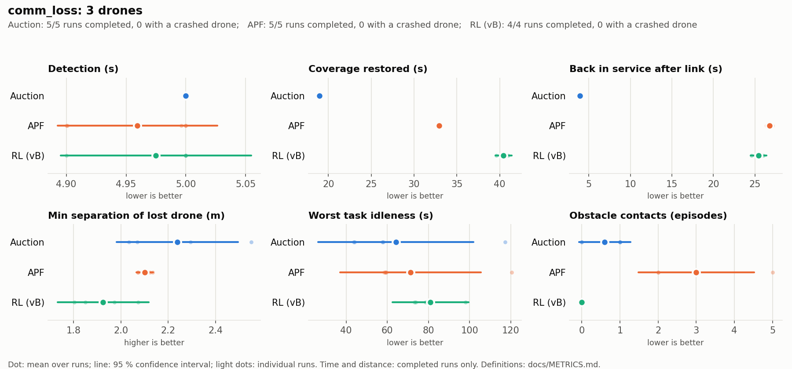
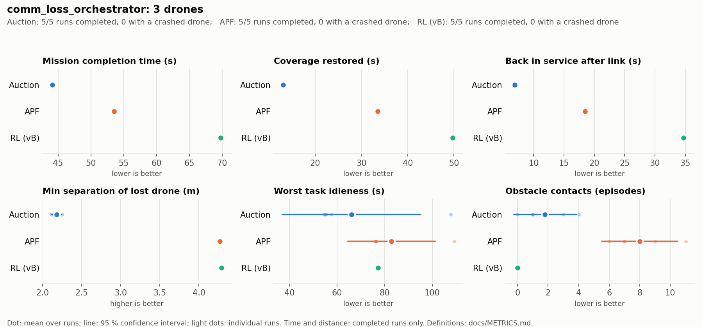

# Benchmark results: auction vs APF vs RL

> **Superseded by [`benchmark_report.pdf`](benchmark_report.pdf).** The report is built from suite
> `suite_final` (`suite_tier1`, 60 runs, plus 8 NMOPSO runs, 2026-10-23), which adds the review-framework metrics (workload imbalance,
> reallocations, allocation latency, separation profile, transient safety). Its tables are in
> [`aggregate.md`](../experiment_results/suites/suite_tier1/aggregate.md). The pattern below is unchanged
> in the new suite: in safety_stress, auction completed 2/5 runs, APF 0/5 and RL 5/5. One finding is
> corrected there: none of the communication-loss contacts happen during the blackout. They happen
> after the link returns and in later patrol laps (report §5.6). Also, in the new suite one RL
> comm_loss run had a drone contact in its second lap, so "zero drone contacts in all runs" (below)
> no longer holds for RL. Its record of zero obstacle contacts still holds.

Suite `suite_20261023`: 3 algorithms × 4 scenarios × 5 repeats, 3 drones, PX4 SITL + Gazebo Harmonic.
- **Source data:** the full tables with every metric, mean ± 95 % confidence interval and n, are in
  [`aggregate.md`](../experiment_results/suites/suite_20261023/aggregate.md); per-run values are in
  `runs.csv` in the same folder.
- **Figures:** one per scenario in [`figures/`](../experiment_results/suites/suite_20261023/figures/).
- **Definitions:** how every metric is calculated is in [`METRICS.md`](METRICS.md).
- **Reproduce:** `./scripts/run_suite.sh <name> 5`, then `python3 scripts/aggregate_suite.py
  experiment_results/suites/<name>` and `python3 presentation/scripts/suite_figures.py
  experiment_results/suites/<name>`.

The algorithms:

| | Allocation | Navigation |
|---|---|---|
| **Auction** | on-board auction (drone 0) | on-board: fixed altitude layers (5–7.5 m), transit via the centre corridor, proximity hold |
| **APF** | same on-board auction | artificial potential field in the coordinator (attraction to the goal, obstacle repulsion gain 0.5 within 1.5 m, drone repulsion) |
| **RL (vB)** | same on-board auction | PPO leg planner `vB_seed2` in the coordinator: waypoints around the obstacle model, route-guided, threat-budgeted |

All three share task allocation and failure detection, so the differences below come from
**navigation** and from **what a drone does when it has no radio**.

"Best" below means the best mean whose 95 % interval does not overlap the runner-up's; otherwise
it is a tie. With n = 5 the intervals are wide where runs differ a lot (crashes, comm loss), so a
tie there means "not separable with 5 runs", not "equal".

One run (RL, `comm_loss`, repeat 5) was stopped by the watchdog because the disk ran low. It says
nothing about RL, so it is left out of the statistics (RL `comm_loss` has n = 4).

## Summary: which algorithm is best at what

| Metric family | Best | Runner-up | Main reason |
|---|---|---|---|
| Speed: mission time, idleness (nominal) | **Auction** ≈ APF | RL (+34 %) | RL plans detours for clearance and its planning stalls the coordinator loop |
| Path length / energy per metre | **APF** | RL | APF flies nearly straight lines; auction climbs to transit layers and goes through the centre corridor |
| Obstacle safety | **RL** | Auction | RL plans around the obstacle model; APF's repulsion is too weak to stop it touching racks |
| Drone-to-drone safety | **RL** | APF | RL's paths spread out; auction drones meet in the shared corridor |
| Completing the hard scenario (`safety_stress`) | **RL** (5/5) | Auction (2/5) | APF crashed a drone in 5/5 runs, auction in 3/5 |
| Decision time | **APF** (0.2 ms) | RL (11 ms mean, ~1.8 s max) | RL's route decomposition runs on the coordinator thread |
| Recovery from communication loss | **Auction** | APF | an auction drone keeps patrolling without radio; APF/RL drones need commands and hover |

No algorithm wins everything. Auction and APF are fast but unsafe in the cluttered scenario. RL is
the only one that is safe everywhere and always completes, but it is slower and recovers worst
from communication loss.

## Scenario by scenario

### `benchmark`: nominal patrol, 6 tasks

| | Auction | APF | RL |
|---|---|---|---|
| Completed | 5/5 | 5/5 | 5/5 |
| Mission time (s) | 44.3 ± 0.1 | **44.2 ± 0.1** (tie) | 59.2 ± 0.7 |
| Flight distance (m) | 254.6 ± 1.0 | **99.6 ± 0.5** | 137.9 ± 3.6 |
| Min obstacle clearance (m) | **1.00 ± 0.02** | 0.47 ± 0.01 | 0.74 ± 0.05 |
| Min drone separation (m) | 2.17 ± 0.03 | 1.98 ± 0.02 | **2.41 ± 0.06** |
| Average task idleness (s) | **12.75 ± 0.02** | 14.85 ± 0.02 | 19.14 ± 0.28 |
| Worst decision time (ms) | – (on board) | **0.6 ± 0.3** | 1783 ± 52 |

- **Auction and APF tie on time** and are both about 15 s faster than RL. They get there differently:
  - APF flies the shortest paths (100 m in total).
  - Auction flies 2.5 times as far, because of its climb to the transit layers and the detour through
    the centre corridor. It still finishes as fast, because transit at altitude is unobstructed.
- **Auction has the best average idleness:** each drone runs its task loop without waiting for the
  ground station.
- **Auction has the most obstacle clearance** in this scenario. Its transit layers are above most
  obstacles, and the tasks here are not near the corridor.
- **APF gets close to obstacles:** 0.47 m minimum clearance, and 0.4 drone-seconds below 0.6 m per run.
  Its repulsion only acts within 1.5 m and is weak against the attraction to the goal.
- **RL keeps 0.74 m from obstacles and the widest separation between drones.** It pays for this in
  distance (+38 % vs APF) and time (+34 %).
- **Why RL is slow:**
  - **Detours:** it plans around the obstacle model instead of along the straight line.
  - **Planning stalls:** when a leg needs route decomposition, the planner blocks the coordinator's
    10 Hz loop for up to about 1.8 s. During that time no drone gets new commands.
- **Worst idleness equals mission time here,** because every task is visited only once. This metric
  only becomes informative in the fault scenarios.

### `safety_stress`: spatial conflicts, 8 tasks

| | Auction | APF | RL |
|---|---|---|---|
| Completed / runs with a crashed drone | 2/5 / 3 | 0/5 / 5 | **5/5 / 0** |
| Task completion (%) | 87.5 ± 15.5 | 87.5 ± 0.0 | **100 ± 0** (tie) |
| Min obstacle clearance (m) | 0.23 ± 0.39 | 0.01 ± 0.03 | **0.74 ± 0.05** |
| Obstacle contacts (episodes) | 1.4 ± 1.9 | 9.6 ± 7.1 | **0 ± 0** (tie) |
| Min drone separation (m) | 0.35 ± 0.21 | 0.89 ± 0.40 | **1.64 ± 0.05** |
| Drone contacts (episodes) | 2.2 ± 2.0 | 0 ± 0 | 0 ± 0 |
| Worst task idleness (s) | 202 ± 166 | 300 ± 0 | **84.7 ± 0.3** (tie) |

This is the scenario that separates the algorithms most clearly.

- **APF crashed a drone in every run.**
  - **Where:** the low task inside a rack aisle and the tasks under transit routes pull a drone
    between obstacles. There the weak repulsion loses to the attraction, and the drone touches racks
    (9.6 contact episodes per run).
  - **Local minima:** a drone can also end up trapped in a local minimum near the ceiling.
  - **Result:** no APF run completed. The task left over is never visited, so worst idleness reaches
    the 300 s window.
- **Auction crashed in 3 of 5 runs,** mostly drone against drone: minimum separation 0.35 m and
  2.2 contact episodes per run.
  - **Cause:** every transit goes through the same centre corridor, and one task sits right beside
    it. Drones meet there, and the proximity hold does not always resolve the encounter.
  - **When it doesn't crash:** it is fast (55 s), which is why its mean time beats RL on the 2
    completed runs.
- **RL completed every run with no contact of either kind.**
  - **Numbers:** obstacle clearance 0.74 m, separation 1.64 m, and the lowest variance of all three.
  - **Why:** its policy plans each leg around the obstacle model, so a task inside an aisle is
    approached along a feasible path instead of being pulled at directly.
  - **Cost:** it takes 85 s.

### `comm_loss`: drone 1 loses its radio for 15 s

| | Auction | APF | RL |
|---|---|---|---|
| Detection (s) | 5.00 ± 0.00 | 4.96 ± 0.07 | 4.98 ± 0.06 |
| Task reassignment (s) | 5.00 ± 0.00 | 4.96 ± 0.07 | 4.98 ± 0.06 |
| Coverage restored (s) | **18.9 ± 0.1** | 32.9 ± 0.2 | 40.5 ± 0.7 |
| Back in service after link returns (s) | **3.9 ± 0.1** | 26.8 ± 0.3 | 25.5 ± 0.7 |
| Mission time (s) | **44.0 ± 0.3** | 53.0 ± 0.2 | 60.5 ± 0.9 |
| Drone contacts (episodes) | 1.2 ± 0.6 | 0.2 ± 0.6 | **0 ± 0** (tie) |
| Obstacle contacts (episodes) | 0.6 ± 0.7 | 3.0 ± 1.5 | **0 ± 0** (tie) |

- **Detection and reassignment are the same for all three (5 s).** They share the on-board heartbeat
  monitor, its 5 s timeout and the auction that reassigns the tasks. This is a property of the
  platform, not of the algorithms.
- **Recovery differs because of what the lost drone does.**
  - **Auction:** the drone keeps flying its task loop without radio. Its tasks keep getting visited:
    coverage is restored after 19 s, and the mission is not delayed at all (44.0 s vs 44.3 s
    nominal). When the link returns, it is back in coordinated service within 4 s.
  - **APF and RL:** the drone gets no movement commands, so it holds its last setpoint. Its tasks are
    covered only after the other drones have been assigned them and flown there: 33 s for APF, 40 s
    for RL. When the link returns, the drone has been declared failed, so it has to win a task in a
    new auction and fly to it from where it hovered: 25–27 s.
- **The auction's autonomy has a cost: more drone-to-drone contacts** (1.2 episodes per run).
  - **Why:** while its radio is down, the lost drone and the drone that inherited its tasks fly to
    the same tasks without seeing each other's positions.
  - **APF and RL:** the lost drone hovers, so it is a stationary obstacle that the others' planners
    can see.
- **APF's obstacle contacts appear here (3 per run) but not in `benchmark`.** The reassigned tasks
  give the remaining drones new, longer routes past obstacles.

### `comm_loss_orchestrator`: drone 0, which runs the auction, loses its radio

| | Auction | APF | RL |
|---|---|---|---|
| Detection | none | none | none |
| Coverage restored (s) | **13.1 ± 0.2** | 33.5 ± 0.1 | 49.7 ± 0.3 |
| Back in service (s) | **6.9 ± 0.2** | 18.5 ± 0.1 | 34.7 ± 0.3 |
| Mission time (s) | **44.2 ± 0.2** | 53.5 ± 0.1 | 69.8 ± 0.3 |
| Drone contacts (episodes) | 2.6 ± 2.3 | 0.2 ± 0.6 | **0 ± 0** (tie) |
| Obstacle contacts (episodes) | 1.8 ± 2.0 | 8.0 ± 2.5 | **0 ± 0** (tie) |

**Single point of failure: no drone detects the loss.** The heartbeat monitor and the auction run
on drone 0, so its silence is never detected and its tasks are never reassigned. Every algorithm
completes only because the link returns after 15 s.

- **Auction:** drone 0 keeps patrolling its own tasks, so coverage is restored within the outage
  (13 s), even without reassignment.
- **APF and RL:** drone 0 hovers until the link is back. Coverage restored is therefore the 15 s
  outage plus the time to resume: 33.5 s for APF and 49.7 s for RL.
- **RL resumes slowest (35 s):** on reconnection, the planner has to plan the whole remaining route
  for drone 0, and the planning stalls add up.
- **Implication for a deployment:** allocation and failure detection should be replicated, or moved
  to the ground station, whichever navigation is used.

## Why each algorithm behaves the way it does

**Auction: fast and autonomous, unsafe in shared space.**
- **Strengths:**
  - Allocation and navigation both run on board, with no per-step ground-station decisions, so it
    has the lowest idleness and recovers best from communication loss.
  - The fixed altitude layers keep it far from floor-level obstacles in open layouts.
- **Weaknesses:**
  - Every transit uses the same corridor at the same layers, so in a cluttered layout drones meet
    and collide (`safety_stress`).
  - Without radio it keeps flying blind next to drones that cannot see it.

**APF: shortest and cheapest paths, weakest safety.**
- **Strengths:** a straight attraction to the goal gives the shortest distance and near-zero decision
  time (0.2 ms).
- **Weaknesses:**
  - Repulsion is local (1.5 m) and weak (gain 0.5), so in tight geometry it touches obstacles and
    gets trapped in local minima: 5/5 runs crashed in `safety_stress`.
  - Higher repulsion gains would trade away some of its speed.

**RL (vB): safest and most reliable, slowest.**
- **Strengths:** the policy plans every leg around an obstacle model, budgeted for threat, so it is
  the only algorithm with zero obstacle and zero drone contacts in all 19 runs, and it completed
  every run.
- **Weaknesses:**
  - Detours cost about a third more mission time than APF.
  - Planning runs on the coordinator's single thread: up to about 1.8 s per decision while route
    decomposition runs, which stalls commands to every drone.
  - Like APF, it depends on the ground station for movement commands, so a lost drone hovers.

## Limitations

- **Sample size:** 5 runs per cell. Intervals are wide where outcomes are bimodal (crash or no crash),
  so some "ties" would likely separate with more runs.
- **Simulation only:** PX4 SITL in Gazebo, without wind or sensor noise beyond PX4's defaults, and
  with a perfect radio except for the injected fault.
- **Untuned parameters:** APF uses one parameter set (gain 0.5, radius 1.5 m), and RL one policy
  (`vB_seed2`). Neither was tuned for these scenarios.
- **One fault model:** a complete radio blackout of one drone, of fixed length (15 s, starting at
  t + 20 s). Partial loss, packet delay and permanent failure are not tested.
- **Decision time is not comparable across all three:** it is measured in the coordinator for APF
  and RL. Auction navigation runs on board and is not timed; its on-board allocation takes under
  0.2 ms.
- **Fixable engineering issues:** RL's planning stalls could be removed by planning in a worker
  thread, and the orchestrator single point of failure by moving the monitor to the ground station.
  Both are platform limits, not properties of the algorithms.
- **Further limits** of the metrics themselves (obstacle model, timestamps) are listed in
  [`METRICS.md`](METRICS.md#known-limitations).

## Videos

`videos/` contains one recorded run per algorithm for `safety_stress` and `comm_loss`. They are
single runs, recorded separately from this suite; how they are made is described in
[`DEMO_RECORDING.md`](DEMO_RECORDING.md).
- `apf_safety_stress.mp4` shows the APF crash.
- `rl_safety_stress.mp4` shows a clean RL completion.
- The `comm_loss` videos show the lost drone's halo turning red, and what each algorithm's drone
  does without radio.

## NMOPSO (suite `suite_final`, 2 runs per scenario)

NMOPSO was added as a fourth algorithm (`--algorithm nmopso`). It uses a vectorised port of the
authors' NMOPSO.m with their parameters. It differs from RL only in how a leg's path is found:
- legs between fixed points are planned before the run (`scripts/precompute_nmopso_cache.py`);
- any other leg is planned in a background thread.

It was run twice per scenario, the other algorithms five times, so its means are measured but no
pairwise significance test involving NMOPSO is possible: the smallest attainable p is 0.095. Full
tables are in [`suite_final/aggregate.md`](../experiment_results/suites/suite_final/aggregate.md); the
discussion is in [`benchmark_report.pdf`](benchmark_report.pdf).

| Scenario | Mission time (s) | Distance (m) | Min. obstacle clearance (m) | Contacts | Recovery |
|---|---|---|---|---|---|
| benchmark | 56.1 (RL 58.7) | 137 (RL 138) | 0.72 | 0 | – |
| safety_stress | 87.6 (RL 84.5), 2/2 completed | 205 | 0.68 | 0 | – |
| comm_loss | 60.5 (RL 60.6) | 138 | 0.69 | 0 | coverage restored 40.5 s (RL 40.6) |
| comm_loss_orchestrator | 66.7 (RL 69.2) | 158 | 0.70 | 0 | coverage restored 46.6 s (RL 49.2) |

- **Safety:** as safe as RL. It completed every run with no obstacle or drone contact.
- **No planning stalls:** its worst control-loop step is about 2 ms, against about 1.6 s for RL, because
  every real leg came from the plan cache. That makes it faster than RL in the nominal and
  orchestrator-loss scenarios.
- **Separation:** less consistent than RL's, because each drone's path is optimised alone.
- **Planning time:** about 5 s per new leg, so it suits fixed patrol rounds in a static layout.
